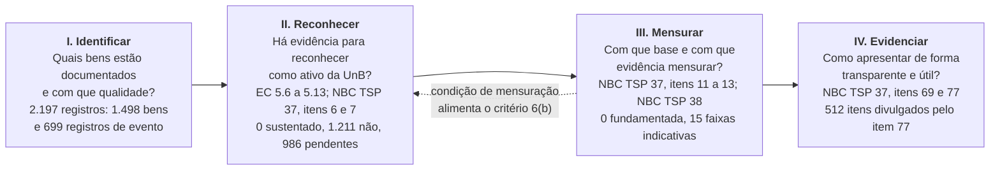
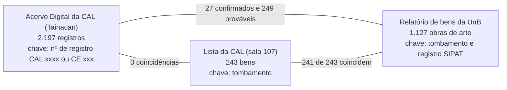

# CULTIVA UnB 2026: Quanto vale o patrimônio cultural da UnB?

Solução da equipe para o Hackathon CULTIVA UnB 2026 (PPGCont/UnB, disciplina Valoração de Ativos Culturais e Ambientais, código 318710; Profa. Fátima de Souza Freire e Prof. Jorge Madeira Nogueira).

Objeto: identificação, reconhecimento, mensuração e evidenciação dos ativos culturais do Acervo Digital da Casa da Cultura da América Latina (CAL/UnB), em https://www.acervocal.unb.br/ (plataforma Tainacan).

Objetivo: processar todos os registros públicos do portal nas quatro etapas contábeis (Regras, item 6.2), com fundamentação na Estrutura Conceitual, na NBC TSP 37 e na NBC TSP 38, rastreabilidade de cada decisão e um fluxo automatizado que pode ser aplicado a novos registros e a outros acervos Tainacan.

Site do projeto: https://atalaiaempreendimentos-bot.github.io/hackhathonunb/ (indicadores, consulta com imagem da obra, ordenação por coluna, reconhecimento e mensuração de cada registro, evidenciação, validação de casos e notas metodológicas).

Resultados acadêmicos; não constituem registro contábil oficial da UnB (Regras, item 17.13).

## Integrantes

- Hugo Rodrigues Gomes
- Yang Alfredo Florentino
- Lucas Moura Nutels

## Estrutura

```
cultiva-unb-trio/
├── README.md
├── rodar_extracao.command          coleta com dois cliques (macOS)
├── rodar_extracao.bat              coleta com dois cliques (Windows)
├── rodar_no_vscode.py              coleta completa pelo botão executar do VS Code
├── baixar_acervo_1565.py           busca da coleção 1565 (páginas 1 a 16) com todos os metadados
├── baixar_acervo_1565_com_fotos.py a mesma busca, com download das fotos (uso autorizado)
├── acervo_1565/                    saída da busca da coleção 1565, com as fotos publicadas (ver Direitos das imagens)
├── index.html                      site do projeto (GitHub Pages)
├── codigos/
│   ├── executar_pipeline.py       executa todas as etapas, em ordem
│   ├── extrair_acervo_cal.py      Etapa I: extrator (API REST do Tainacan), sem dependências externas
│   ├── verificar_duplicidades.py  Etapa I: verificação de registros duplicados
│   ├── identificacao_inbcm.py     Etapa I: elementos do INBCM (Resolução Normativa Ibram nº 6/2021) e classificação pelo Tesauro
│   ├── reconhecimento.py          Etapa II: matriz de reconhecimento
│   ├── mensuracao.py              Etapa III: modelo de mensuração
│   ├── comparaveis.py             Etapa III: abordagem de mercado por comparáveis
│   ├── validacao_casos.py         Produto 4: validação de nove casos
│   ├── evidenciacao.py            Etapa IV: nota explicativa, quadro consolidado e indicadores
│   ├── cadastro_patrimonial.py    conciliação com o cadastro patrimonial da UnB (Lista da CAL)
│   ├── cadastro_unb_relatorio.py  valor de cada registro no relatório de bens da UnB (obras de arte)
│   ├── ler_numbers.py             leitor de planilhas Apple Numbers, sem dependências
│   ├── versoes_anteriores/        versões anteriores do extrator
│   └── coletar_no_navegador.js    coleta alternativa pelo Console do navegador
├── dados/                          saída do extrator (ver dicionario_dados.md após rodar)
├── metodologia/
│   ├── identificacao.md
│   ├── reconhecimento.md
│   ├── mensuracao.md
│   └── evidenciacao.md
├── resultados/
│   ├── indicadores/indicadores_item15.csv
│   ├── demonstrativos/quadro_consolidado.csv e valor_agregado_por_base.csv
│   ├── nota_explicativa/minuta_nota_explicativa.md
│   └── validacao_casos.md
├── relatorio_final/relatorio_tecnico_cientifico.md   minuta do Produto 7
└── apresentacao/roteiro_apresentacao.md              roteiro do Produto 9
```

## Fluxo completo (todas as etapas)

O desafio pergunta como identificar, reconhecer, mensurar e evidenciar os ativos culturais da CAL/UnB de forma sistemática, fundamentada, transparente e reproduzível (Regras, item 2). Cada etapa responde a uma pergunta orientadora das Regras e tem metodologia, código e resultados próprios:



| Etapa | Pergunta orientadora (Regras) | Metodologia | Código | Resultado principal |
|---|---|---|---|---|
| I. Identificar | Quais bens culturais estão documentados e qual a qualidade das informações? (item 7). Padrão de referência: INBCM (Resolução Normativa Ibram nº 6/2021) | [`identificacao.md`](metodologia/identificacao.md) | `extrair_acervo_cal.py`, `verificar_duplicidades.py`, `identificacao_inbcm.py`, `cadastro_patrimonial.py`, `cadastro_unb_relatorio.py` | `dados/inventario.csv`, `dados/identificacao_inbcm.csv` |
| II. Reconhecer | Quais registros têm evidência suficiente para o reconhecimento como ativos da UnB? (item 8) | [`reconhecimento.md`](metodologia/reconhecimento.md) | `reconhecimento.py` | `dados/reconhecimento.csv` |
| III. Mensurar | Como mensurar, considerando características, finalidade e evidências? (item 9) | [`mensuracao.md`](metodologia/mensuracao.md) | `comparaveis.py`, `mensuracao.py` | `dados/mensuracao.csv` |
| IV. Evidenciar | Como apresentar as informações de forma transparente e útil à gestão pública? (item 10) | [`evidenciacao.md`](metodologia/evidenciacao.md) | `evidenciacao.py` | `resultados/nota_explicativa/minuta_nota_explicativa.md` |
| V. Inovação | Como tornar os procedimentos eficientes, atualizáveis e reproduzíveis? (item 11) | este README | `executar_pipeline.py` | um comando reproduz I a IV |

O critério 6(b) do reconhecimento (mensuração confiável) depende da Etapa III; por isso o código calcula a mensuração antes de concluir o reconhecimento, como mostra a seta tracejada. Números de 24/11/2026; os atualizados estão no site e em `resultados/indicadores/indicadores_item15.csv`.

Dependências: Python 3.8 ou superior, apenas biblioteca padrão. Opcional: `openpyxl`, para a planilha `.xlsx`. O site é estático (HTML e JavaScript), sem bibliotecas externas além das fontes do Google.

```bash
python3 codigos/executar_pipeline.py                     # reprocessa as respostas já baixadas (dados/brutos)
python3 codigos/executar_pipeline.py --atualizar         # baixa de novo o portal antes de reprocessar
python3 codigos/executar_pipeline.py --cadastro Lista_da_CAL.numbers   # inclui a conciliação patrimonial
python3 codigos/executar_pipeline.py --relatorio-bens relatorio_bens_UnB_Total.xlsx   # valor de cada registro no cadastro da UnB
```

Ordem: Etapa I (`extrair_acervo_cal.py` e `verificar_duplicidades.py`), conciliação patrimonial (opcional), Etapa III (`comparaveis.py`, que chama `mensuracao.py`), Etapa II (`reconhecimento.py`, que usa a condição de mensuração), validação (`validacao_casos.py`) e Etapa IV (`evidenciacao.py`). O resultado é determinístico: a mesma entrada produz os mesmos arquivos.

### Aplicação a novos registros e a outros acervos (Etapa V)

- Novos registros da CAL: `--atualizar` baixa o portal de novo e todas as etapas são recalculadas.
- Outro acervo Tainacan: `python3 codigos/executar_pipeline.py --atualizar --base https://outro-acervo/wp-json/tainacan/v2`. O de-para de campos (`dados/mapeamento_campos.csv`) é revisável, e as regras de grupo, reconhecimento e mensuração ficam em funções isoladas de cada script.
- Novas evidências de mercado: uma linha em `dados/comparaveis.csv`, com fonte, e o fluxo recalcula níveis, faixas e indicadores.

## Resultados (23/11/2026)

| Indicador (Regras, item 15) | Resultado |
|---|---|
| Registros identificados e recuperados | 2.197 e 2.197 |
| Cobertura | 100,0% do universo digital |
| Completude cadastral | 32,9% |
| Registros duplicados (possíveis) | 48: 4 em provável duplicidade (Memória Institucional) e 44 a conferir no Acervo; nenhum identificador repetido |
| Reconhecimento sustentado | 0 |
| Reconhecimento pendente | 986 (outros 1.211 com não reconhecimento fundamentado: 512 pelo item 7 da NBC TSP 37 e 699 eventos) |
| Mensuração fundamentada | 0 |
| Mensuração pendente | 638, dos quais 15 com faixa indicativa (nível C) |
| Valor agregado estimado | R$ 0,00 (não é o valor do patrimônio da CAL) |
| Rastreabilidade | 100,0% |
| Validação | 9 casos |

Cadastro patrimonial da UnB: a Lista da CAL (sala 107) tem 242 obras de arte, 232 próprias com valor registrado de R$ 1.765.385,00 e 10 de terceiros (R$ 173.015,00), sem tombamento em comum com o portal. O relatório de bens da UnB com todas as obras de arte (1.127 bens; 1.009 nas localidades da CAL, R$ 2.266.832,63) vincula 27 registros do portal por identificador e 249 por procedência; o valor de cada registro aparece na coluna "Valor no cadastro da UnB" do site (`dados/valores_cadastro_unb.csv`, `resultados/conciliacao_cadastro_unb.md`). Detalhes em `resultados/nota_explicativa/minuta_nota_explicativa.md`.

## Etapa I: como reproduzir a extração

Requisito: Python 3.8 ou superior. Nada mais precisa ser instalado. Se o pacote `openpyxl` estiver presente, o script também gera `dados/CULTIVA_acervo_CAL.xlsx`.

### Opção A: terminal

```bash
cd cultiva-unb-trio
python3 codigos/extrair_acervo_cal.py --saida dados
```

Em 23/11/2026 o portal apresentou certificado TLS vencido (o navegador exibe o aviso "Sua conexão não é particular"). Nessa situação o Python recusa a conexão e o script explica o erro. Se a equipe decidir aceitar o risco, por se tratar de dados públicos e de consulta somente leitura:

```bash
python3 codigos/extrair_acervo_cal.py --saida dados --sem-verificar-ssl
```

A opção fica registrada em `dados/log_extracao.json` e deve constar das limitações.

### Opção B: navegador

1. Abrir https://www.acervocal.unb.br/ no Chrome.
2. Abrir o Console (Cmd+Option+J no Mac; Ctrl+Shift+J no Windows). Se o Chrome pedir, digitar `allow pasting`.
3. Colar todo o conteúdo de `codigos/coletar_no_navegador.js` e teclar Enter.
4. O navegador baixa `acervo_cal_bruto_AAAAMMDD_HHMM.json`.
5. Rodar: `python3 codigos/extrair_acervo_cal.py --saida dados --importar caminho/do/acervo_cal_bruto_....json`

As duas opções produzem as mesmas tabelas.

### Arquivos gerados em `dados/`

| Arquivo | Conteúdo |
|---|---|
| `inventario.csv` | Base padronizada com as variáveis do item 7 das Regras (identificador, coleção, categoria, título, autoria ou grupo de origem, ano, técnica, materiais, dimensões, proveniência, forma de aquisição, localização, estado de conservação, nº de patrimônio, descrição, fonte e URL), mais triagem de grupo, completude e duplicidade |
| `identificacao_inbcm.csv` | Para cada bem, os elementos do INBCM (Resolução Normativa Ibram nº 6/2021, art. 7º, § 1º) presentes e ausentes, outros números propostos e classificação proposta pelo Tesauro de Objetos (FERREZ, 2016); resumo em `identificacao_inbcm_resumo.csv` |
| `vocabulario_tesauro.csv` | Vocabulário revisável: denominação do portal, termo e código do Tesauro, verificação |
| `bens_recentes_cadastro.csv` | Subgrupo da triagem: 27 bens do relatório de bens da UnB com denominação descritiva, tombados de 2024 a 2026, sem registro no acervo digital |
| `inventario_excel.csv` | A mesma base com separador `;` (Excel em português) |
| `inventario_bruto_longo.csv` | Todos os metadados de todos os itens, um valor por linha, sem perda de informação |
| `por_colecao/*.csv` | Uma planilha por coleção, com os campos originais do portal |
| `colecoes.csv` | Itens declarados, total informado pela API e itens recuperados, por coleção |
| `metadados_colecoes.csv` | Definição dos campos de cada coleção |
| `mapeamento_campos.csv` | De-para campo original para variável padronizada, com a regra aplicada |
| `diagnostico_qualidade.csv` | Percentual de preenchimento de cada variável, por coleção e por grupo |
| `duplicidades.csv` | Possíveis duplicidades (mesmo ID, mesmo nº de patrimônio, mesmo título+autoria+dimensões) |
| `indicadores.csv` | Registros identificados, recuperados, cobertura, completude, duplicidades, rastreabilidade |
| `metadados_completos.csv` | Uma linha por item com todos os metadados de todas as coleções e os links e arquivos das fotos |
| `galeria.html` | Galeria para o navegador: foto e todos os metadados, com busca e filtros |
| `imagens/` | Fotos, somente com autorização da CAL registrada (`--autorizacao`) |
| `miniaturas_3x4/` | Miniaturas das 1.244 fotos (até 240 × 320 px, a obra inteira, sem corte), exibidas em 3 × 4 cm na coluna Imagem da Obra da consulta do site |
| `dicionario_dados.md` | Dicionário de dados gerado automaticamente |
| `log_extracao.json` | Data, parâmetros, requisições, avisos, erros e limitações |
| `brutos/` | Respostas originais da API (JSON) com URL e data de consulta |
| `mensuracao.csv` | Modelo de mensuração aplicado a cada registro: categoria, base, técnica, nível de evidência, situação, valor (quando houver evidência) e nota metodológica |
| `mensuracao_resumo.csv` | Contagem por situação e valor agregado por base e categoria |
| `evidencias_mensuracao.csv` | Evidências preenchidas pela equipe ou geradas por `comparaveis.py` (fonte obrigatória) |
| `comparaveis.csv` | Transações e estimativas de obras comparáveis, com fonte, para a abordagem de mercado |

### Pelo VS Code

- Coleta da coleção 1565 com todos os metadados: abra `baixar_acervo_1565.py` e clique em executar (Run Python File), ou, no terminal do VS Code, `python3 baixar_acervo_1565.py`. Resultado em `acervo_1565/`.
- Coleta de todas as coleções com o pacote completo de tabelas: `python3 rodar_no_vscode.py`, ou Terminal > Run Task > CULTIVA.

Cada obra fica ligada à sua foto pelos links (`url_foto_original`/`url_foto`, `url_foto_1024px`/`url_foto_grande`) e pela galeria (`galeria_acervo_1565.html`, `dados/galeria.html`), que exibe a foto do portal ao lado de todos os metadados.

### Etapa III: mensuração

`python3 codigos/comparaveis.py` aplica a abordagem de mercado a partir de `dados/comparaveis.csv` e, em seguida, `python3 codigos/mensuracao.py` aplica o modelo de mensuração a todos os registros de `dados/inventario.csv` e gera `dados/mensuracao.csv` e `dados/mensuracao_resumo.csv`. Valores entram somente por `dados/evidencias_mensuracao.csv`, com fonte e nível de evidência (A a D); sem evidência, o registro fica com a situação justificada (pendente, sem mensuração monetária fundamentada, fora do escopo ou pendente de classificação). Metodologia em `metodologia/mensuracao.md`. No site, a coluna de mensuração mostra o valor quando ele existe, com a nota metodológica ao passar o mouse.

### Fundamentação normativa

Os modelos seguem o texto publicado da NBC TSP Estrutura Conceitual (R1), da NBC TSP 37 (Ativo Imobilizado) e da NBC TSP 38 (Mensuração), conferido em 24/11/2026; as três vigoram a partir de 1º/01/2027 e são aplicadas antecipadamente, como pedem as Regras. Itens usados, síntese e links em `metodologia/fundamentacao_normativa.md`. Em resumo: definição de ativo pelos itens 5.6 a 5.13 da Estrutura Conceitual; reconhecimento pelos itens 6 e 7 da NBC TSP 37 (patrimônio cultural sem mensuração confiável não é reconhecido e é divulgado pelo item 77); mensuração inicial pelo custo atribuído, determinado pelo valor corrente operacional (NBC TSP 37, itens 12 e 27; NBC TSP 38, itens 10 e 23 a 25); evidenciação pelos itens 69 e 77 da NBC TSP 37 e 54 e 55 da NBC TSP 38.

### Etapa II: reconhecimento

`python3 codigos/reconhecimento.py` aplica a matriz do item 8 a cada registro e grava `dados/reconhecimento.csv` (existência, controle, potencial de serviços, benefícios econômicos, natureza, condição de mensuração, classe, justificativa, investigação necessária, restrições e referência normativa). Regras de decisão em `metodologia/reconhecimento.md`.

### Conciliação com o cadastro patrimonial

`python3 codigos/cadastro_patrimonial.py Lista_da_CAL.numbers` lê o cadastro patrimonial (formato Numbers ou CSV), descarta nome do responsável e matrículas e grava `dados/cadastro_patrimonial_cal.csv` (item a item) e `dados/conciliacao_patrimonial.csv` (agregados). Só os agregados são publicados: o arquivo original contém dados pessoais e a versão item a item fica fora do repositório público até a equipe confirmar a autorização de divulgação (Regras, item 12).

### Validação e Etapa IV

`python3 codigos/validacao_casos.py` gera a validação dos nove casos (`resultados/validacao_casos.md`), e `python3 codigos/evidenciacao.py` gera a minuta de nota explicativa, o quadro consolidado e os indicadores do item 15 em `resultados/`.

### Direitos das imagens

As fotografias são do Acervo Digital da Casa da Cultura da América Latina (CAL/UnB), https://www.acervocal.unb.br/, com direitos reservados (Lei nº 9.610/1998). No campo "Condições de reprodução", o portal informa que elas não podem ser baixadas e/ou reproduzidas sem autorização.

As 1.244 fotos da pasta `acervo_1565/imagens/` (lista em `acervo_1565/fotos_publicadas.csv`) são publicadas neste repositório e no site para fins acadêmicos, com autorização para publicação online declarada pela equipe em 23/11/2026. Registro da autorização: a publicação das fotos foi autorizada e atualizada por Hugo Rodrigues Gomes, integrante da equipe, que responde por ela (declaração em 23/11/2026; registro neste README em 24/11/2026). Os direitos autorais das obras pertencem aos seus autores. Cada foto aparece com crédito ao Acervo CAL e link para o registro original. Titulares de direitos podem pedir a retirada de qualquer imagem abrindo uma issue neste repositório. A reprodução por terceiros continua sujeita à autorização da CAL/UnB.

Os scripts continuam sem baixar fotos por padrão; o download exige registrar a autorização (`AUTORIZACAO_CAL` em `baixar_acervo_1565.py` ou `--autorizacao` no extrator).

### Revisão do de-para

O de-para inicial usa palavras-chave nos nomes dos campos e, quando existir, o mapeamento Dublin Core do Tainacan. Para corrigir: editar a coluna `variavel_padronizada` de `dados/mapeamento_campos.csv` (várias variáveis podem ser unidas com `+`, ou a célula pode ficar vazia) e rodar, sem acessar a rede:

```bash
python3 codigos/extrair_acervo_cal.py --saida dados --offline --mapa dados/mapeamento_campos.csv
```

### Cuidados

- Coleta com pausa de 1 s entre requisições, novas tentativas com espera crescente e cache local (Regras, item 17.12).
- Imagens e documentos não são baixados; apenas seus endereços são registrados (Regras, item 12, sobre restrições de divulgação).
- `grupo_sugerido` e `flag_possivel_contemporanea` são triagens automáticas por palavra-chave e precisam de revisão da equipe.
- Cobertura do acervo digital não equivale à cobertura do patrimônio físico da CAL (Regras, item 4.4).
- O mesmo script funciona em outros portais Tainacan (`--base https://...`), o que atende à demonstração de aplicação a outros acervos públicos (Regras, item 5, passo 12).

## Fontes

- TAINACAN. **Tainacan**: uma plataforma de repositórios flexível e poderosa para WordPress. [S. l.], 2026. Disponível em: https://tainacan.org/. Acesso em: 24 nov. 2026.
- FERREZ, Helena Dodd. **Tesauro de Objetos do Patrimônio Cultural nos Museus Brasileiros**. [S. l.], 2016.
- INSTITUTO BRASILEIRO DE MUSEUS. Resolução Normativa Ibram nº 6, de 31 de agosto de 2021. Normatiza o Inventário Nacional dos Bens Culturais Musealizados. **Diário Oficial da União**: seção 1, Brasília, DF, 2 set. 2021.
- UNIVERSIDADE DE BRASÍLIA. Casa da Cultura da América Latina. Acervo Digital da CAL. Disponível em: https://www.acervocal.unb.br/. Data de acesso: registrada em `dados/log_extracao.json`.
- Regras do Hackathon CULTIVA UnB 2026 (PPGCont/UnB, 2026).

## Registro de uso de inteligência artificial

| Data | Ferramenta | Uso | Verificação pela equipe |
|---|---|---|---|
| 23/11/2026 | Claude (Anthropic) | Rascunho do extrator, do trecho para navegador, deste README e do roteiro de trabalho | Código testado contra API simulada no formato do Tainacan |
| 23/11/2026 | Claude (Anthropic) | Abordagem de mercado por comparáveis (`codigos/comparaveis.py`), pesquisa de comparáveis na web e filtros por artista e por situação no site | Fontes registradas em `dados/comparaveis.csv`; equipe deve conferir cada fonte antes da defesa |
| 23/11/2026 | Claude (Anthropic) | Modelo de mensuração (`codigos/mensuracao.py`, `metodologia/mensuracao.md`) e coluna de mensuração no site | Nenhum valor monetário atribuído sem evidência; regras de categoria a revisar pela equipe |
| 23/11/2026 | Claude (Anthropic) | Site do projeto (`index.html`, GitHub Pages) com indicadores, consulta, galeria e créditos das fotos | Fotos conferidas: 1.244 imagens válidas, cada uma ligada ao registro na planilha |
| 24/11/2026 | Claude (Anthropic) | Identificação pelo INBCM (Resolução Normativa Ibram nº 6/2021), classificação pelo Tesauro de Objetos e subgrupo dos 27 bens recentes do cadastro (`codigos/identificacao_inbcm.py`, `codigos/cadastro_unb_relatorio.py`) | Texto da norma conferido no portal do Ibram; termos do Tesauro conferidos no texto publicado, com equivalências a confirmar marcadas; nada é completado além do que está escrito na denominação |
| 24/11/2026 | Claude (Anthropic) | Fluxo das etapas no site e no README; documentação da falta de chave comum entre o acervo digital e o cadastro patrimonial, com indicadores de grupo em `dados/conciliacao_patrimonial.csv` | Texto da limitação redigido a partir de parágrafo do Hugo; descrição do Tainacan conferida em tainacan.org; indícios de grupo não usados como vínculo obra a obra |
| 24/11/2026 | Claude (Anthropic) | Árvore de decisão da triagem por grupo (extrator 1.2.0): natureza do registro, grupo do bem e resíduo pela sequência do número de registro | Critério gravado em cada registro; inferência pela sequência marcada como provável; versão 1.1.3 preservada em `codigos/versoes_anteriores/` |
| 24/11/2026 | Claude (Anthropic) | Leitura do relatório de bens da UnB (obras de arte), vínculo com os registros do portal e coluna "Valor no cadastro da UnB" no site (`codigos/cadastro_unb_relatorio.py`) | Vínculo confirmado só por identificador; vínculo por procedência marcado como provável; nenhum valor atribuído a registros sem vínculo; nomes e matrículas descartados |
| 24/11/2026 | Claude (Anthropic) | Verificação de duplicidades (`codigos/verificar_duplicidades.py`); retirada da seção Galeria do site; ordenação por coluna na consulta | Grupos a conferir listados por ID e número de registro, para checagem na CAL |
| 24/11/2026 | Claude (Anthropic) | Consulta ao texto publicado da Estrutura Conceitual (R1), da NBC TSP 37 e da NBC TSP 38 (legisweb.com.br e legismap.com.br); ajuste dos modelos de reconhecimento, mensuração e evidenciação aos itens conferidos (`metodologia/fundamentacao_normativa.md`); coluna de fotos 3 × 4 no site; relatório de aderência v2 | Itens citados conferidos no texto das normas; apêndices de orientação não consultados; nenhum valor atribuído sem evidência |
| 23/11/2026 | Claude (Anthropic) | Matriz de reconhecimento, validação de casos, evidenciação (nota explicativa, quadro consolidado, indicadores), leitor de Numbers, conciliação com o cadastro patrimonial, metodologia, minutas do relatório e da apresentação, notas metodológicas no site e relatório de aderência às Regras | Regras de decisão a revisar pela equipe; parágrafos das normas a conferir; nenhum valor atribuído sem evidência |
| 23/11/2026 | Claude (Anthropic) | Versões 1.1.x do extrator (links das fotos, metadados completos, galeria), scripts `baixar_acervo_1565*.py`, tarefas do VS Code e diagnóstico das obras sem foto | Coletas executadas pela equipe em 23/11/2026: 2.197 registros em 3 coleções; 1.497 obras e 1.245 fotos da coleção 1565, sem falhas |

## Limitações

Registradas até 23/11/2026 (completar ao longo do hackathon):

- O portal apresentou certificado TLS vencido em 23/11/2026; a coleta foi feita sem verificação do certificado, por decisão da equipe. As respostas brutas (`dados/brutos/`) registram URL e horário de cada consulta; os reprocessamentos posteriores são offline e constam de `dados/log_extracao.json`.
- A Coleção CNRC, listada no item 4.3 das Regras, não aparece em nenhum registro público do portal.
- **Identificação frente ao INBCM.** Pela Resolução Normativa Ibram nº 6/2021, nenhum dos 1.498 bens tem os 9 elementos de descrição obrigatórios, e o portal não tem os incisos II (outros números, onde caberia o tombamento) e VII (classificação por vocabulário controlado). A classificação proposta pelo Tesauro de Objetos alcança 938 bens; 560 ficam a classificar. Há ainda 27 bens recentes no cadastro patrimonial (R$ 113.800,00) sem registro no acervo digital (`metodologia/identificacao.md`).
- **Acervo digital sem chave patrimonial.** O Acervo Digital da CAL, instância do Tainacan (TAINACAN, 2026), identifica as obras pelo número de registro museológico (CAL.xxxx, CE.xxx) e não informa o tombamento do sistema patrimonial da UnB, salvo na coleção Mobiliário moderno ("Código patrimonial"). A Lista da CAL identifica cada obra só pelo tombamento, sem título ou autoria. Nenhum dos 243 tombamentos aparece nos metadados do portal; no relatório de bens da UnB, 27 registros têm chave comum. A limitação é de catalogação, não do software. Efeito: o cadastro não serve de evidência de controle nem de custo atribuído obra a obra, e os bens que satisfazem a definição de ativo seguem o item 7 da NBC TSP 37. Detalhes, indícios de que a lista corresponde à subcoleção Triangular e encaminhamentos em [`metodologia/identificacao.md`](metodologia/identificacao.md) e [`metodologia/reconhecimento.md`](metodologia/reconhecimento.md).


- A cobertura refere-se ao universo digital público: 2.197 registros em 3 coleções (Acervo, 1.497; Memória Institucional, 699; Mobiliário moderno da UnB, 1), todos recuperados. Isso não equivale ao patrimônio físico da CAL (Regras, item 4.4).
- Completude cadastral média de 32,9% nas 13 variáveis principais. Duplicidades: nenhum identificador repetido; 4 registros em provável duplicidade (Memória Institucional) e 44 a conferir na CAL (`resultados/verificacao_duplicidades.md`).
- A triagem por grupo (árvore de decisão do extrator 1.2.0) não deixa registro "A classificar": os 699 da Memória Institucional são registros de evento, não bens; a Cadeira UnB vai para Arte (design autoral); o ID 25320, com "Coleção = False", vai para Etnográfica como provável, pela sequência do número de registro (`metodologia/identificacao.md`). A triagem continua sujeita a revisão da equipe.
- Poucos comparáveis de mercado (dois), em dólar e sem conversão; o portal não informa dimensões e tiragem de muitas obras. A validação dos nove casos é documental, sem exame físico na CAL.
- Na coleção 1565, 252 obras não têm foto no portal (181 da coleção Inicial, 39 da Galvão, 21 da Arte, 10 da Triangular e 1 sem coleção informada). Há inconsistências cadastrais: o ID 11924 (Videoarte, CE.008) consta "Com imagem? = Sim" sem foto; os IDs 1715 e 25973 têm o campo vazio; o ID 25320 tem "Coleção = False".
- O portal informa, para 1.237 das 1.245 obras com foto da coleção 1565, que as fotografias não podem ser baixadas e/ou reproduzidas (Lei nº 9.610/1998). As fotos foram baixadas e publicadas para fins acadêmicos; a publicação foi autorizada e atualizada por Hugo Rodrigues Gomes, integrante da equipe (declaração em 23/11/2026, registrada em 24/11/2026). A foto do ID 2841 não foi publicada: o portal devolveu uma página de erro no lugar da imagem.
