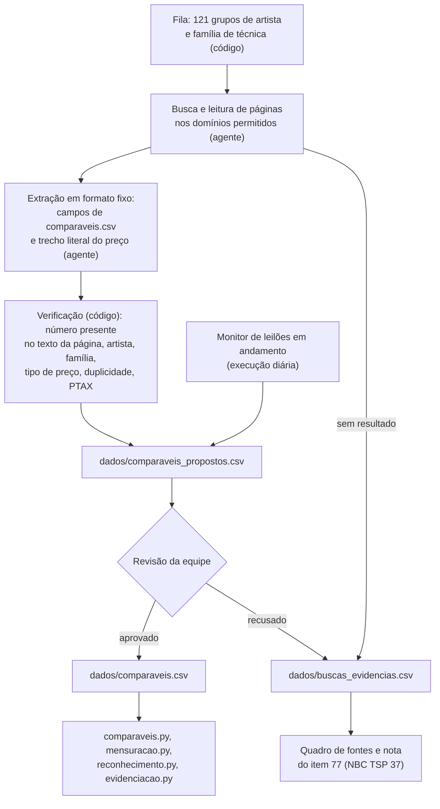

# Agente de evidências de preço (proposta)

Proposta para a Etapa V (Regras, item 11), ainda não implementada nem testada. O agente procura e organiza evidências de mercado para a Etapa III. Ele não atribui valor a nenhuma obra: a falta de evidência continua sem ser substituída por estimativa arbitrária ou por valor gerado por inteligência artificial (Regras, itens 9.4 e 17.10). O nível de cada evidência continua saindo de `codigos/comparaveis.py`. Um comparável só entra em `dados/comparaveis.csv` depois que um integrante da equipe o aprova.

## Por que automatizar

A busca manual de 24/11/2026 (`metodologia/mensuracao.md`, seção "Busca em fontes externas") encontrou três obstáculos. As fontes abertas trazem estimativa ou último lance, raramente venda realizada. Os portais de leilão brasileiros retiram os lotes depois do pregão, de modo que o resultado some se ninguém o registrar a tempo. Cada consulta depende de alguém repetir buscas por artista e técnica, sem registro do que já foi pesquisado.

O agente trata os dois últimos: repete as buscas de forma registrada e acompanha os leilões em andamento para guardar o resultado antes que o lote saia do ar. O primeiro obstáculo depende de decisões da equipe (assinatura de bases pagas, laudo de avaliador, documentos da UnB) e não se resolve com automação.

## Escopo

Dos 638 registros que podem receber mensuração pela abordagem de mercado, 1 não tem autoria e 182 têm técnica sem família reconhecida pela função `familia_de` de `codigos/comparaveis.py` (vídeo, técnica mista e outras). Os 455 restantes formam 121 grupos de artista e família de técnica, que são a unidade de busca do agente. Os 182 registros sem família ficam fora da primeira versão até que a equipe atribua a família de cada um.

A fila segue o número de registros do grupo. Os 10 maiores grupos reúnem 253 registros:

| Grupo (artista, família de técnica) | Registros | Com definição de ativo atendida |
|---|---|---|
| Charlote Gross, desenho | 45 | 1 |
| Milan Dusek, gravura em metal | 40 | 15 |
| Maciej Babinski, gravura em metal | 38 | 21 |
| Zeila Navarro Swain, litografia | 37 | 37 |
| Johann Georg Scheuermann, desenho | 23 | 1 |
| Maciej Babinski, desenho | 19 | 0 |
| Cícero Dias, serigrafia | 14 | 0 |
| Francisco Cuoco, desenho | 13 | 0 |
| Zeila Navarro Swain, pintura | 12 | 12 |
| Clóvis Graciano, gravura em metal | 12 | 0 |
| Total | 253 | 87 |

Em 55 dos 121 grupos há registros que atendem à definição de ativo. São esses os registros que `codigos/reconhecimento.py` trata como prováveis bens já registrados no cadastro patrimonial. Enquanto o vínculo com o cadastro não for resolvido, a evidência encontrada para eles serve para conferir o valor registrado no cadastro e não deve levar ao reconhecimento no acervo digital (ver a fase 0).

## Fluxo

## Etapas

1. Fila (código). Lê `dados/inventario.csv`, `dados/mensuracao.csv` e `dados/reconhecimento.csv` e monta um item por grupo de artista e família de técnica. Ficam fora os bens de comunidades tradicionais (Regras, item 4.3), os registros de evento, os registros sem autoria e os sem família. Cada item leva as grafias alternativas do nome do artista (com e sem acento, por exemplo).
2. Busca e leitura (agente). Uma chamada ao modelo por grupo, com as ferramentas de busca e de leitura de páginas limitadas aos domínios da lista permitida. A instrução pede os lotes daquele artista naquela família de técnica com preço publicado.
3. Extração (agente). A resposta segue um esquema fixo com as colunas de `dados/comparaveis.csv` mais dois campos: o trecho literal da página que mostra o preço e o trecho que mostra se houve venda ("arrematado", "vendido", "price realized", "último lance").
4. Verificação (código). Recusa a proposta quando:
   - algum número extraído não aparece no texto da página lida, depois de normalizar os formatos (R$ 1.234,56 e US$ 2,040 viram 1234.56 e 2040);
   - o artista ou a família de técnica não coincidem com o grupo, pela mesma função `familia_de`;
   - o tipo de preço é "arrematado" sem palavra de venda no trecho literal.

   O último lance entra como `oferta`, que já é dado não observável, até a equipe decidir se cria um tipo próprio. O código também marca o mesmo lote publicado em dois sites (mesma casa, data, título e dimensões), lê nas condições de venda se o preço inclui o prêmio do comprador ("não informado" quando a página não diz) e converte valores em moeda estrangeira pela cotação PTAX do Banco Central do Brasil na data do leilão, com a taxa e a fonte na observação.
5. Proposta e revisão (equipe). As propostas vão para `dados/comparaveis_propostos.csv` com as colunas `status` (pendente, aprovado ou recusado), `revisor` e `motivo`. Só as linhas aprovadas passam para `dados/comparaveis.csv`. A partir daí, o fluxo atual (`comparaveis.py`, `mensuracao.py`, `reconhecimento.py`, `evidenciacao.py`) segue sem mudança.
6. Registro das buscas (código). Toda consulta fica em `dados/buscas_evidencias.csv`: grupo, fonte, consulta, data e hora, número de resultados e motivo de recusa. Busca sem resultado também é registrada. Esse arquivo alimenta o quadro de fontes de `metodologia/mensuracao.md` e a nota explicativa do item 77 da NBC TSP 37, que pede a divulgação das dificuldades de mensuração.

## Monitor de leilões em andamento

Uma execução diária procura, nos catálogos abertos do LeilõesBR e do iArremate, lotes dos artistas da fila. Cada lote encontrado é registrado com endereço, casa, data do pregão e lance do dia, como `oferta`. Depois da data do pregão, o monitor volta à página. Se ela mostrar o resultado da venda, o lote vira proposta de comparável `arrematado`. Se o lote tiver saído do ar ou só mostrar o último lance, o registro fica como "resultado não publicado" e o agente redige um pedido do resultado à casa de leilão, que um integrante da equipe envia.

O lote de Maciej Babinski em pregão na Martha Burle Escritório de Arte em 26/11/2026 é o tipo de caso que o monitor captaria. Com o tempo, a CAL passaria a ter uma série própria de vendas dos artistas do acervo.

## Fontes

| Fonte | Uso pelo agente | Tipo de preço esperado | Testada em 24/11/2026 |
|---|---|---|---|
| Invaluable, LiveAuctioneers, Art.Salon e sites das casas internacionais (Bonhams, Christie's, Phillips, Sotheby's) | Busca de resultados publicados | `arrematado`, quando o resultado é público | Invaluable e Art.Salon, pela busca aberta |
| Bolsa de Arte, cotações por artista | Busca | `oferta` (último lance) | Sim |
| LeilõesBR e iArremate | Monitor de pregões | `oferta` durante o pregão; `arrematado` só com resultado publicado | Sim |
| Catálogo das Artes, Artnet, Artprice, MutualArt | Fora do agente: bases pagas, sem acesso automático com login | Consulta manual da equipe, se houver assinatura | Catálogo das Artes |
| Documentos da UnB (termos de empréstimo e de doação, processos do Sistema Eletrônico de Informações) | Fora da busca: a equipe envia o arquivo e o agente só extrai os campos | Nível a definir pela equipe (`metodologia/mensuracao.md`) | Não |

Antes de incluir um site na lista permitida, a equipe confere o arquivo robots.txt e os termos de uso. A coleta respeita pausa entre requisições, como no extrator (Regras, item 17.12).

## Travas

1. Nenhum número sem origem: cada valor proposto precisa aparecer no texto da página lida. O código confere isso antes de qualquer revisão.
2. O modelo não calcula: mediana, nível de evidência, conversão de moeda e ajustes ficam no código, que já existe para isso.
3. Nada entra em `dados/comparaveis.csv` sem aprovação de um integrante da equipe.
4. Só domínios da lista permitida, sem login, sem assinatura e sem contornar verificação contra robôs.
5. As cópias das páginas lidas são conteúdo de terceiros e ficam fora do repositório público, numa pasta incluída no `.gitignore`. O repositório publica o endereço, a data e a hora, o hash SHA-256 da cópia e o trecho com o preço. Imagens não são guardadas.
6. Cada execução é registrada no quadro de uso de inteligência artificial do README, com data, modelo e grupos pesquisados.

## Implementação proposta

- Script `codigos/agente_evidencias.py`, a escrever. O próprio script controla o laço: monta a fila, faz uma chamada por grupo, verifica as respostas e grava os arquivos. O restante do repositório continua só com a biblioteca padrão do Python; o kit de desenvolvimento (SDK) oficial `anthropic` seria dependência apenas desse script.
- Modelo `claude-opus-5-5`, pela interface de programação (API) do Claude, com as ferramentas de busca e de leitura de páginas da própria API (`web_search_20260209` e `web_fetch_20260209`) limitadas aos domínios permitidos. A resposta usa saída estruturada no esquema de `comparaveis.csv`.
- O texto devolvido pela ferramenta de leitura é a base da verificação do item 1 das travas e da cópia guardada fora do repositório.
- Chave da API fora do repositório, em variável de ambiente ou em segredo do GitHub Actions, se o monitor rodar lá.
- Custo e tempo por grupo serão medidos no piloto.

## Fases

0. Pré-requisitos, antes de ligar o agente:
   - mudar a ordem dos testes em `codigos/reconhecimento.py`, para que o vínculo com o cadastro venha antes do nível A ou B e uma obra não seja contada duas vezes;
   - definir em que nível entram laudo e valor de seguro;
   - decidir se o último lance continua como `oferta` ou ganha tipo próprio em `codigos/comparaveis.py`;
   - atribuir família de técnica aos 182 registros sem família.
1. Piloto com os 10 maiores grupos (253 registros), com saída só na fila de revisão.
2. Monitor diário dos leilões em andamento.
3. Aplicação a outros acervos Tainacan, com o mesmo parâmetro `--base` do extrator.

## Indicadores do piloto

- Grupos pesquisados, do total de 121.
- Transações realizadas encontradas por grupo e grupos com três ou mais, o mínimo do nível B.
- Propostas aprovadas e recusadas na revisão, que medem a qualidade da extração.
- Registros que mudaram de nível de evidência.
- Buscas sem resultado registradas.
